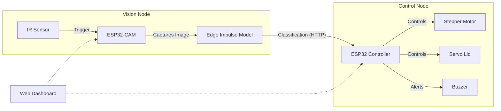

# AI Smart Waste Sorter 🤖♻️

An intelligent, dual-core IoT system that automatically classifies and sorts waste into **Metal**, **Plastic**, or **Paper** categories using Computer Vision on the edge.

## 🌟 Project Overview

This project leverages **Edge Impulse** to deploy a lightweight Machine Learning model directly onto an ESP32-CAM. The system is split into two independent modules for maximum performance:

1.  **Vision Node (ESP32-CAM)**: Captures images, runs the AI inference, and hosts a live web dashboard.
2.  **Control Node (ESP32)**: Receives classification data via HTTP, drives the stepper motor for sorting, and manages the lid servo.

### Key Features
*   **Real-time Edge AI**: Runs offline inference (FOMO/MobileNet) with <200ms latency.
*   **Dual-Web Interface**: Separate dashboards for the Camera Feed and Manual Motor Control.
*   **Static IP Architecture**: Seamless Android/Mobile access via fixed network addresses.
*   **Robust Sorting Logic**: 3-streak confirmation algorithm to prevent false positives.
*   **Hardware Calibration**: Manual control mode to fine-tune stepper motor angles.

---

## 🏗️ System Architecture

The system uses a distributed approach to prevent the heavy AI processing from interfering with precise motor control.

---

## 🔌 Hardware Setup

### 1. Vision Node (ESP32-CAM)
*   **Power**: 5V stable supply.
*   **Active Peripherals**:
    *   **IR Sensor**: Connected to `GPIO 15`. Detects waste presence to wake up the AI.

### 2. Control Node (ESP32)
*   **Power**: Needs a **Dual-Rail Setup**. ESP32 powered via USB, Motors powered via **External 5V**.
*   **Pin Mapping**:

| Component | ESP32 Pin | Notes |
| :--- | :--- | :--- |
| **Stepper IN1** | GPIO 13 | ULN2003 Driver |
| **Stepper IN2** | GPIO 18 | ULN2003 Driver |
| **Stepper IN3** | GPIO 14 | ULN2003 Driver |
| **Stepper IN4** | GPIO 19 | ULN2003 Driver |
| **Servo Signal** | GPIO 26 | Lid Control |
| **Buzzer (+)** | GPIO 23 | Signal |

> **⚠️ CRITICAL**: Connect the GND of your external 5V power supply to the ESP32 GND!

---

## 🧠 Edge Impulse Integration

The core intelligence is built using [Edge Impulse](https://edgeimpulse.com).

1.  **Data Collection**: 500+ images of local waste items (cans, bottles, paper scraps) were collected using the ESP32-CAM.
2.  **Training**: A customized MobileNetV2 was trained with Transfer Learning to recognize our specific 3 classes.
3.  **Deployment**: The model was exported as an **Arduino Library**, allowing it to run entirely offline on the ESP32-CAM.

---

## 🚀 Installation

### 1. Network Configuration
The system is pre-configured with **Static IPs** for easy access:
*   **Camera Dashboard**: `http://192.168.0.200`
*   **Bin Controller**: `http://192.168.0.201`

*(Modify `local_IP` in the code if your router uses a different subnet like 192.168.1.x)*

### 2. Flash the Vision Node
1.  Open `esp32_camera/esp32_camera.ino`.
2.  Install the **Edge Impulse Library** zip via Arduino IDE.
3.  Select Board: **AI Thinker ESP32-CAM**.
4.  Upload.

### 3. Flash the Control Node
1.  Open `esp32_bin_controller/esp32_bin_controller.ino`.
2.  Select Board: **DOIT ESP32 DEVKIT V1**.
3.  Upload.

---

## 🎮 Usage

### Automatic Mode
Simply place an item in front of the IR sensor. The camera will:
1.  Detect the object.
2.  Wait for **3 consecutive confirmations** of the same class.
3.  Send the sort command to the Bin Controller.

### Manual Mode (Maintenance)
Access `http://192.168.0.201` to:
*   Test motor rotation (Left/Right continuous hold).
*   Jump to specific bin positions (`Metal`, `Plastic`, `Paper`).
*   Open/Close the lid manually.

---

## 📝 License
This project is open-source and available under the [MIT License](LICENSE).
