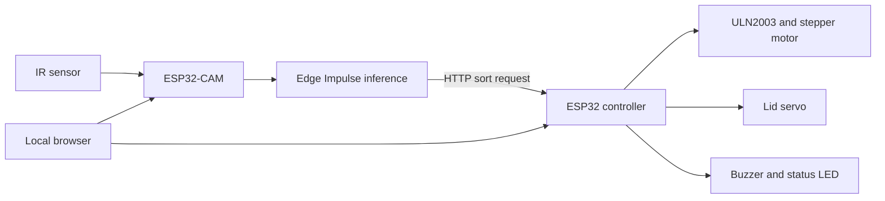

# ESP32 Vision-Based Waste Sorter

A two-board embedded prototype that combines camera inference with a motorized sorting mechanism. An ESP32-CAM runs an Edge Impulse model and sends a waste label over the local network; a second ESP32 moves a stepper motor and opens a servo-controlled lid.

The project demonstrates TinyML integration, HTTP communication between devices, GPIO control, and browser-based monitoring. The repository contains application firmware; the trained model export and mechanical design are separate prerequisites.

## System design

The camera performs inference when its active-low IR input detects an object. In the object-detection branch, labels `metal`, `plastic`, and `paper` above the `0.6` confidence threshold contribute to a three-match confirmation counter. A successful request increments session counters and starts a five-second pause. Missing detections do not clear that branch's confirmation counter.

The controller accepts the three labels, moves to the configured bin offset, opens the lid, waits two seconds, closes it, and returns to its starting offset. Motor operations are blocking; HTTP acknowledgment means the request was accepted, not that the physical cycle completed.

## Repository layout

| Path | Responsibility |
| --- | --- |
| [esp32_camera/esp32_camera.ino](esp32_camera/esp32_camera.ino) | Camera configuration, IR trigger, inference, HTTP client, and monitoring page |
| [esp32_bin_controller/esp32_bin_controller.ino](esp32_bin_controller/esp32_bin_controller.ino) | Stepper sequence, servo control, buzzer, and control page |

## Hardware and software

- AI Thinker ESP32-CAM with camera and PSRAM.
- A separate ESP32 development board for actuator control.
- Active-low IR object sensor; 28BYJ-48 stepper and ULN2003 driver; lid servo; buzzer.
- A regulated supply appropriate for the boards and actuators, with a shared ground. Power actuators through their suitable external supply and driver.
- Arduino IDE with ESP32 board support and the `ESP32Servo` library.
- An Edge Impulse Arduino export that provides `WasteSorter2_inferencing.h` and the Edge Impulse SDK. This export is **not included** in the repository.

The camera sketch carries an upstream example note for ESP32 Arduino core `2.0.4`. No project-wide dependency lock or verified build matrix is included; confirm library and board-package compatibility before changing versions.

### Pin mapping

The camera's built-in camera connections use the AI Thinker mapping declared in its sketch. Its additional IR input is GPIO `15`.

| Controller peripheral | GPIO |
| --- | --- |
| ULN2003 IN1 / IN2 / IN3 / IN4 | `13` / `18` / `14` / `19` |
| Servo signal | `26` |
| Buzzer | `23` |
| Status LED | `2` |

Check signal voltages, boot-pin constraints, and actuator travel against your board and mechanical assembly. The startup routine energizes each stepper output briefly.

## Setup

1. Obtain or train the matching Edge Impulse model and import its Arduino library. Confirm that the model labels match the firmware path you intend to use.
2. Open each sketch in its own Arduino project. Select AI Thinker ESP32-CAM for the camera and the board definition matching the controller hardware.
3. Set the Wi-Fi credentials locally in both sketches. Keep real credentials out of commits and public screenshots.
4. Update `local_IP`, `gateway`, and `subnet` for both devices, and set `binControllerIP` in the camera sketch to the controller's address. Reserve the chosen addresses to avoid DHCP conflicts.
5. Review `METAL_SWING_STEPS`, `PLASTIC_SWING_STEPS`, `PAPER_SWING_STEPS`, and the servo angles against the unloaded mechanism. The current offsets are `1264`, `-1264`, and `0`; they are calibration values, not universal angles.
6. Upload the controller and camera firmware. Open each serial monitor at `115200` baud and check initialization and network status.

Default local pages are `http://192.168.0.200/` for vision monitoring and `http://192.168.0.201/` for actuator control. The camera also attempts mDNS registration as `wastesorter-cam.local`.

## Operation and validation

Use a trusted, isolated local network: the firmware provides plain HTTP endpoints without authentication. Anyone able to reach them can view snapshots or issue motor commands. Do not expose these devices through router port forwarding.

1. Check the camera page and `/status` output before placing an object at the IR sensor. The displayed feed polls `/snapshot`; it is not a continuous streaming endpoint.
2. With the mechanism clear, verify each controller position using its manual controls and return it home.
3. Present one item at a time and compare the serial label, confirmation counter, HTTP result, and physical bin movement.
4. Test low-confidence objects, object removal between detections, Wi-Fi interruption, and a disconnected controller. Record the board/core/library versions and observed timing with any demonstration.

## Current limitations

- The repository does not include model weights, training data, accuracy measurements, latency benchmarks, or a mechanical drawing.
- The image-classification branch accepts `contaminated` where the controller expects `paper`; align the label handling before using that model type. Its dashboard updates also differ from the object-detection branch.
- The object-detection confirmation counter can survive missing detections, so three matches need not be consecutive frames.
- Manual rotation has no automatic timeout, end-stop, or physical position feedback. The `/test` step count is not bounded.
- Camera and motor endpoints need authentication and request validation before use beyond an isolated demonstration. Blocking movement limits responsiveness during a cycle.
- A classifier-error return path does not free the allocated image buffer; repeated errors can exhaust memory.

## Attribution and licensing

The camera sketch retains the Edge Impulse example copyright and permission notice. A repository-wide license file is not currently provided; model exports and third-party libraries also have their own terms.
